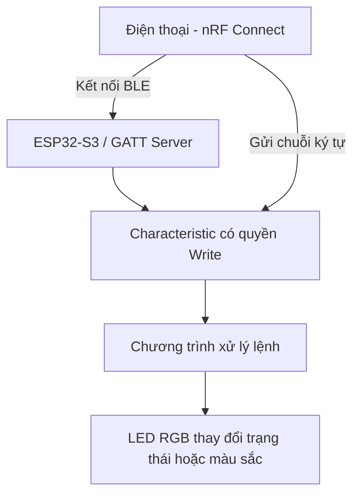

BÀI THỰC HÀNH: ĐIỀU KHIỂN LED QUA BLUETOOTH LOW ENERGY (BLE) BẰNG nRF CONNECT

Tài liệu thực hành dành cho người mới học IoT, được đối chiếu với video BLT.mp4 do người thực hiện cung cấp. Các ảnh bên dưới được trích từ video. Những chi tiết về mã nguồn hoặc chân phần cứng không thể xác minh từ video sẽ được ghi rõ là thông tin tham khảo.

---

PHẦN 1. GIỚI THIỆU

Bài thực hành sử dụng điện thoại chạy ứng dụng nRF Connect để kết nối tới thiết bị Bluetooth Low Energy (BLE) và gửi dữ liệu điều khiển LED trên bo mạch. Trong video, thiết bị BLE hiển thị với tên `VTT`. Điện thoại truy cập một đặc tính (GATT characteristic) có quyền `Write` và `Write Without Response`, sau đó gửi giá trị và quan sát LED đổi màu.

Bluetooth Low Energy là phương thức liên lạc không dây tầm ngắn. Trong mô hình này, điện thoại là thiết bị trung tâm (central/GATT client) còn ESP32-S3 là thiết bị ngoại vi (peripheral/GATT server) khi chạy chương trình BLE tương ứng. Không cần WiFi hoặc Home Assistant để gửi lệnh trực tiếp từ nRF Connect.

PHẦN 2. MỤC TIÊU

- Biết dùng ứng dụng nRF Connect để quét và kết nối thiết bị BLE.
- Nhận biết Service, Characteristic và quyền ghi dữ liệu trong GATT.
- Biết nhập lệnh theo dạng văn bản UTF-8 và gửi bằng chức năng Write.
- Quan sát phản hồi của LED để kiểm tra dữ liệu được xử lý.
- Phân biệt BLE với Bluetooth Classic và WiFi.

PHẦN 3. THÀNH PHẦN CẦN CHUẨN BỊ

- Một bo mạch ESP32-S3 có hỗ trợ BLE. Theo bài học trước, người thực hiện sử dụng ESP32-S3; video cho thấy một bo mạch có LED đổi màu. Không thể xác nhận tuyệt đối mã bo mạch và chân LED chỉ từ video.
- Cáp USB để cấp nguồn và nạp chương trình.
- Điện thoại có Bluetooth và ứng dụng nRF Connect.
- Máy tính có Arduino IDE và gói board ESP32 nếu cần biên dịch/nạp lại mã.
- LED RGB tích hợp tương thích hoặc LED gắn ngoài đúng loại, đúng chân theo bo mạch thực tế.

PHẦN 4. SƠ ĐỒ NGUYÊN LÝ

Luồng hoạt động: nRF Connect kết nối với thiết bị BLE → chọn characteristic được phép ghi → nhập giá trị → gửi qua kết nối BLE → vi điều khiển nhận và xử lý → LED thay đổi.

PHẦN 5. KẾT QUẢ CÓ THỂ QUAN SÁT TỪ VIDEO

- Điện thoại đã vào giao diện thiết bị `VTT` và trạng thái bên dưới thể hiện `Connected`.
- nRF Connect hiển thị các service GATT: `Generic Access (1800)`, `Generic Attribute (1801)` và một service riêng có UUID hiển thị trong video.
- Characteristic điều khiển hiển thị các quyền `Write` và `Write Without Response`.
- Giao diện cho phép chọn kiểu dữ liệu như `UTF-8` khi gửi giá trị.
- Trên màn hình có thao tác nhập giá trị `4` (khoảng giây 12–15) và giá trị `2` (khoảng giây 27–30). Video cho thấy LED sáng ánh tím/xanh trong phần đầu và chuyển sang ánh đỏ ở đoạn sau (khoảng giây 33).
- Các hình ảnh cho thấy việc tương tác bằng nRF Connect đi kèm thay đổi màu LED, nhưng không có mã nguồn gốc để xác minh đầy đủ quy ước lệnh → màu. Không khẳng định chắc chắn lệnh `4` phải ra màu tím hoặc lệnh `2` phải ra màu đỏ đối với mọi chương trình.
- Dòng `No Services found` ở khu vực `Advertised Services` không đồng nghĩa với lỗi kết nối: ngay bên dưới, mục `Connected Services` vẫn hiển thị các service GATT của thiết bị.

PHẦN 6. HƯỚNG DẪN THỰC HIỆN

Bước 1: Cấp nguồn cho ESP32-S3 bằng cáp USB. Đảm bảo chương trình BLE đã được nạp và đang phát quảng bá (advertising) với tên thiết bị muốn kết nối.

Bước 2: Bật Bluetooth trên điện thoại. Mở ứng dụng nRF Connect, vào phần quét thiết bị (Scanner) và tìm thiết bị tên `VTT` nếu bạn dùng đúng tên giống video. Tên có thể khác nếu chương trình của bạn thay đổi tên quảng bá.

Bước 3: Chọn `CONNECT`. Khi kết nối thành công, nRF Connect sẽ hiển thị danh sách các service và characteristic. Ở video, tên thiết bị `VTT` và trạng thái `Connected` hiển thị ở cuối màn hình.

Bước 4: Mở service tùy chỉnh, tìm characteristic có quyền `Write` hoặc `Write Without Response`. Trong video, service được hiển thị là `12345678-1234-1234-1234-1234567890AB` và characteristic là `12345678-1234-1234-1234-1234567890AC`. UUID phải khớp với chương trình BLE thực tế trên bo mạch của bạn.

Bước 5: Nhấn biểu tượng ghi (mũi tên hướng lên) của characteristic. Ở cửa sổ `Write Value`, lựa chọn định dạng `UTF-8` khi muốn gửi ký tự số dạng văn bản thay vì giá trị nhị phân.

Bước 6: Nhập lệnh theo quy ước của chương trình được nạp. Video cho thấy thao tác nhập ký tự số trong ô Write Value.

Bước 7: Nhấn `WRITE` để gửi, quan sát LED và kiểm tra kết quả. Lặp lại thao tác với giá trị khác, ví dụ số `2` như đã xuất hiện trong video.

PHẦN 7. GIẢI THÍCH THUẬT NGỮ

- BLE (Bluetooth Low Energy): công nghệ giao tiếp Bluetooth tiết kiệm năng lượng, thường dùng cho thiết bị IoT và cảm biến.
- Advertising: thiết bị BLE phát thông tin quảng bá để điện thoại có thể tìm thấy.
- Central: thiết bị chủ động quét và kết nối, trong bài là điện thoại.
- Peripheral: thiết bị phát quảng bá và nhận kết nối, trong bài là vi điều khiển đã chạy BLE.
- GATT: cấu trúc trao đổi dữ liệu dựa trên Service và Characteristic.
- Service: nhóm các chức năng/dữ liệu của thiết bị, nhận dạng bằng UUID.
- Characteristic: trường dữ liệu có thể đọc/ghi/thông báo, được nhận dạng bằng UUID.
- Write: thao tác ghi dữ liệu có phản hồi ở tầng giao thức GATT.
- Write Without Response: thao tác ghi không yêu cầu phản hồi ghi ở tầng GATT; không đồng nghĩa với đảm bảo ứng dụng đã xử lý lệnh.
- UTF-8: kiểu mã hóa ký tự; nhập chuỗi `2` theo UTF-8 khác với ghi một byte nhị phân có giá trị 2.

PHẦN 8. MÃ NGUỒN THAM KHẢO

Tệp [ESP32S3_BLE_RGB_tham_khao.ino](ESP32S3_BLE_RGB_tham_khao.ino) là chương trình ví dụ riêng để các bạn có thể thử lại bài trên ESP32-S3. Đây không phải mã gốc được trích xuất từ video, vì video không chứa mã nguồn.

Chương trình tham khảo tạo tên thiết bị `VTT`, Service UUID và Characteristic UUID giống các giá trị nhìn thấy trong video. Chân LED `GPIO48` là cấu hình thường gặp với một số bo ESP32-S3 có LED WS2812 tích hợp nhưng không áp dụng cho mọi bo; cần kiểm tra đúng chân trên bo đang sử dụng.

Quy ước RIÊNG của mã tham khảo (không phải bảng lệnh được xác minh từ clip):

- `0`: tắt LED.
- `1`: màu đỏ.
- `2`: màu xanh dương.
- `3`: màu xanh lá.
- `4`: màu tím.
- `5`: màu trắng.

Lưu ý đối chiếu clip: sau thao tác nhập `2`, LED trong clip xuất hiện màu đỏ, trong khi mã ví dụ này quy định `2` là xanh dương. Như vậy mã `.ino` tham khảo không thể coi là chương trình gốc trong video. Nếu muốn tài liệu và chương trình khớp tuyệt đối, cần có file mã nguồn thực sự đã nạp lên bo mạch.

Để chạy chương trình tham khảo:

1. Mở Arduino IDE, cài gói `esp32` của Espressif trong Boards Manager.
2. Chọn board ESP32-S3 phù hợp, chẳng hạn `ESP32S3 Dev Module` nếu đó là bo bạn dùng.
3. Cài thư viện `Adafruit NeoPixel` qua Library Manager; phần BLE được cung cấp bởi thư viện BLE tương thích với phiên bản gói ESP32 đang dùng.
4. Kiểm tra `LED_PIN` và loại LED WS2812 trên bo; sửa nếu chân/loại LED khác.
5. Nạp file `.ino`, sau đó mở Serial Monitor 115200 để xem thiết bị khởi động.
6. Mở nRF Connect, quét `VTT`, kết nối, chọn characteristic và gửi `0` đến `5` dạng UTF-8.

PHẦN 9. KIỂM TRA KẾT QUẢ

- Kiểm tra 1: điện thoại tìm thấy thiết bị BLE `VTT` và kết nối thành công.
- Kiểm tra 2: xem được service và characteristic có quyền Write.
- Kiểm tra 3: gửi một chuỗi ký tự bằng nRF Connect và quan sát trạng thái LED.
- Kiểm tra 4: gửi giá trị khác, kiểm tra LED có đổi màu/trạng thái theo quy ước code đang nạp.
- Kiểm tra 5: ngắt kết nối, quét lại và kết nối lại để kiểm tra khả năng phát quảng bá trở lại.

Nếu dùng đúng file ví dụ trong gói này, bảng lệnh có thể kiểm tra theo các giá trị 0–5 ở Phần 8. Nếu dùng chương trình gốc thì phải dựa trên bảng lệnh thực sự của chương trình gốc, không lấy bảng lệnh minh họa làm kết luận.

PHẦN 10. LỖI THƯỜNG GẶP VÀ CÁCH XỬ LÝ

- Không tìm thấy tên VTT: kiểm tra ESP32-S3 đã có nguồn, chương trình BLE đang chạy, điện thoại đã bật Bluetooth và thiết bị chưa bị ứng dụng khác giữ kết nối.
- Kết nối được nhưng không thấy UUID giống video: kiểm tra đúng firmware, vì UUID do mã chương trình BLE quy định.
- Có nút Write nhưng LED không đổi: kiểm tra định dạng gửi (UTF-8 hay byte nhị phân), giá trị lệnh, chân DATA của LED và loại LED.
- Không có nút Write: bạn có thể đã mở nhầm characteristic chỉ hỗ trợ Read hoặc Notify.
- ESP32-S3 báo lỗi `Adafruit_NeoPixel.h: No such file or directory`: cài thư viện Adafruit NeoPixel trong Arduino IDE.
- LED không sáng sau khi nạp ví dụ: xác minh phần cứng thực tế có WS2812, chân LED và cách cấp nguồn phù hợp; không phải mọi ESP32-S3 đều dùng GPIO48.
- Bị ngắt BLE: thử đưa điện thoại tới gần, kiểm tra nguồn USB và kết nối lại.
- Gửi ký tự `2` nhưng kết quả không như mong đợi: phân biệt chuỗi UTF-8 "2" (byte hex `32`) với byte có giá trị `02`.

PHẦN 11. VIDEO THỰC HÀNH

[Xem video BLT.mp4](BLT.mp4)

Video do người thực hiện cung cấp, có thời lượng khoảng 40 giây. Hình trích trong tài liệu được lấy từ video này.

PHẦN 12. KẾT LUẬN

Bài thực hành minh họa phương thức điều khiển thiết bị IoT bằng Bluetooth Low Energy thông qua ứng dụng nRF Connect. Người học biết tìm thiết bị, kết nối BLE, định vị characteristic cho phép ghi và gửi dữ liệu để quan sát phản hồi của LED. Mô hình có thể tiếp tục phát triển thành điều khiển nhiều thiết bị, đọc cảm biến hoặc xây dựng ứng dụng điện thoại riêng.

PHẦN 13. LƯU Ý VỀ TÍNH CHÍNH XÁC

Các thao tác trên nRF Connect, tên `VTT`, các quyền Write, việc nhập `4` và `2`, các ảnh LED đổi màu và video BLT.mp4 được ghi nhận từ tài liệu đã cung cấp. Sự xuất hiện màu đỏ sau thao tác nhập `2` là quan sát theo trình tự hình ảnh, chưa phải bằng chứng đầy đủ về quy ước xử lý lệnh trong firmware. Kết luận về bo ESP32-S3 và chân LED dựa trên ngữ cảnh học tập trước đó và phần mã minh họa; không thể xác minh từ hình ảnh đơn lẻ. File `.ino` kèm theo là ví dụ độc lập để học tập và cần nạp thử trên bo thực tế. Không công bố địa chỉ MAC, mật khẩu hay khóa bảo mật thật trong GitHub.
