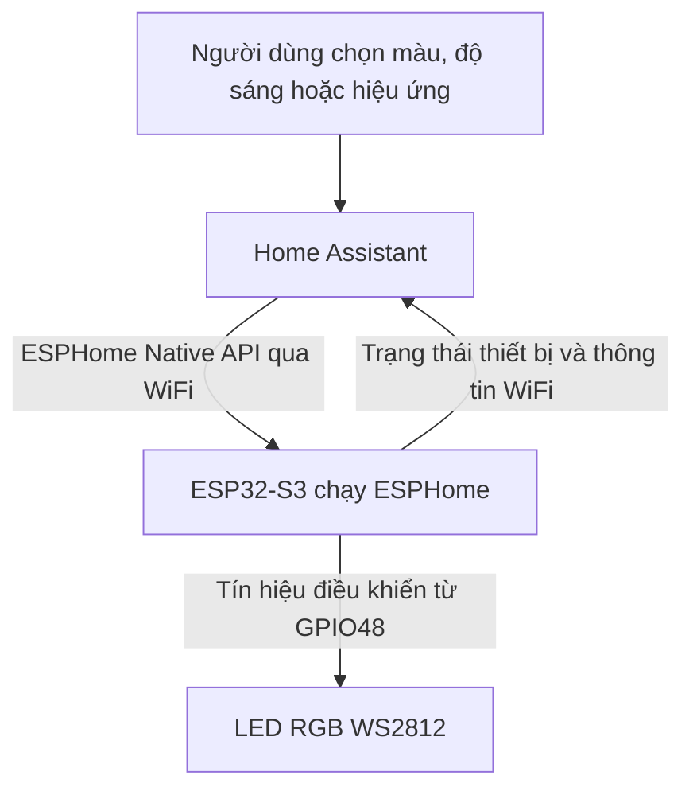
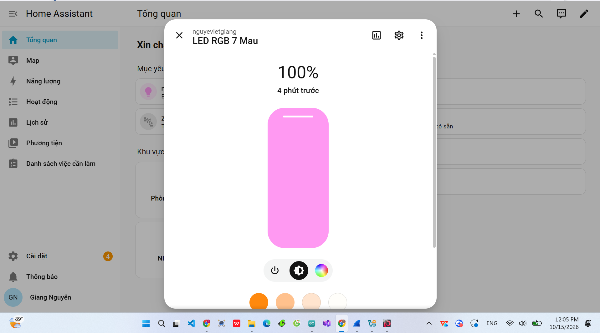
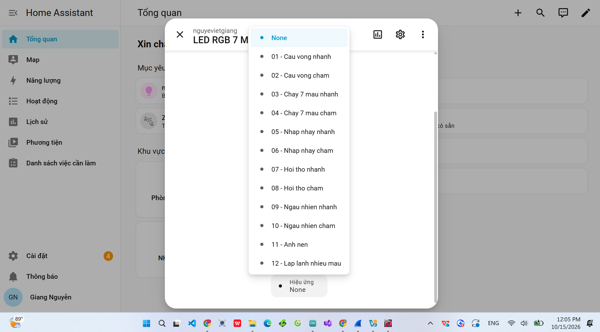

<p>BÀI THỰC HÀNH – ĐIỀU KHIỂN LED RGB 7 MÀU VÀ 12 HIỆU ỨNG BẰNG HOME ASSISTANT QUA WIFI</p>

Tài liệu hướng dẫn dành cho các bạn muốn làm lại bài thực hành với ESP32-S3, ESPHome và Home Assistant. Nội dung được viết theo mã ESPHome, ba ảnh chụp giao diện và video thực hành của bài này. Tên “LED RGB 7 Mau” là tên thiết bị trong mã; chương trình thực tế cung cấp bộ chọn màu RGB và 12 hiệu ứng có sẵn.

---

<p>1. GIỚI THIỆU BÀI THỰC HÀNH</p>

Trong bài này, ESP32-S3 kết nối WiFi và giao tiếp với Home Assistant thông qua API gốc của ESPHome. Người dùng điều khiển một LED RGB có thể lập trình (WS2812) trên giao diện Home Assistant mà không cần viết một ứng dụng điện thoại riêng.

Các chức năng có thể thực hiện:

- Bật và tắt LED từ giao diện Home Assistant.
- Chọn màu tùy ý trên bảng màu RGB hoặc dùng các màu gợi ý.
- Tăng, giảm độ sáng từ 0% đến 100%.
- Chọn một trong 12 hiệu ứng đã khai báo trong ESPHome.
- Theo dõi trạng thái kết nối ESP, cường độ tín hiệu WiFi, thời gian hoạt động, địa chỉ IP, tên WiFi đang kết nối.
- Khởi động lại thiết bị từ Home Assistant thông qua nút được khai báo trong ESPHome.

Bài này là điều khiển qua WiFi và ESPHome Native API, không dùng Bluetooth, Zigbee hoặc MQTT trong cấu hình được cung cấp.

---

<p>2. THIẾT BỊ VÀ PHẦN MỀM CẦN CÓ</p>

- 01 bo ESP32-S3 có LED RGB WS2812 tương thích, LED dữ liệu kết nối tại GPIO48 trong cấu hình hiện tại.
- 01 cáp USB truyền dữ liệu để cấp nguồn và nạp chương trình lần đầu.
- Máy tính hoặc thiết bị có thể truy cập Home Assistant.
- Mạng WiFi mà ESP32-S3 kết nối được; Home Assistant cần liên lạc mạng với ESP32-S3.
- Home Assistant và ESPHome Device Builder (ESPHome được tích hợp trong Home Assistant hoặc một môi trường ESPHome phù hợp).

Chú ý phần cứng: GPIO48 là chân đang được dùng trong bài đã cung cấp, không phải là chân LED RGB mặc định của mọi bo ESP32-S3. Nếu bo của bạn khác, kiểm tra sơ đồ chân thực tế trước khi dùng. Nếu LED WS2812 là loại lắp ngoài, cần nối VCC, GND và DIN đúng theo mô-đun, nối chung GND với ESP32-S3 và bảo đảm mức nguồn phù hợp. Không nối GPIO trực tiếp vào chân nguồn của LED.

---

<p>3. NGUYÊN LÝ HOẠT ĐỘNG</p>



Quy trình:

1. Người dùng mở trang Tổng quan (Overview) của Home Assistant, chọn thiết bị “LED RGB 7 Mau”.
2. Người dùng bật/tắt LED, chọn màu hoặc chọn một hiệu ứng.
3. Home Assistant chuyển lệnh qua mạng đến ESP32-S3 bằng API của ESPHome.
4. ESP32-S3 tạo tín hiệu điều khiển WS2812 bằng ngoại vi RMT tại GPIO48.
5. LED hiển thị màu, độ sáng hoặc hiệu ứng tương ứng; trạng thái thiết bị được cập nhật trên Home Assistant khi kết nối hoạt động.

Với `num_leds: 1`, chương trình điều khiển một điểm LED. Hiệu ứng cầu vồng được quan sát dưới dạng thay đổi màu theo thời gian trên một điểm LED, không phải nhiều dải màu cùng xuất hiện như trên một dải nhiều LED.

---

<p>4. CHUẨN BỊ VÀ NẠP CẤU HÌNH ESPHOME</p>

Bước 1. Kết nối bo ESP32-S3 với máy tính bằng cáp USB truyền dữ liệu, kiểm tra máy tính nhận cổng kết nối.

Bước 2. Mở ESPHome Device Builder, thêm thiết bị ESP32-S3 hoặc mở cấu hình ESPHome của thiết bị đã có. Sử dụng nội dung của file:

[led_rgb_7_mau.yaml](led_rgb_7_mau.yaml)

Bước 3. Cấu hình thông tin mạng trong file `secrets.yaml` trên hệ thống ESPHome bằng các khóa tương ứng, ví dụ:

```yaml
wifi_ssid: "TEN_WIFI_CUA_BAN"
wifi_password: "MAT_KHAU_WIFI_CUA_BAN"
fallback_ap_password: "MAT_KHAU_DU_PHONG_RIENG"
```

Các giá trị trên chỉ là ví dụ, cần thay bằng thông tin thực tế. Không đăng file `secrets.yaml` chứa mật khẩu thật lên GitHub. Nếu bạn dùng cấu hình cũ, hãy thay mật khẩu điểm phát dự phòng đã từng xuất hiện trong mã nguồn công khai.

Bước 4. Kiểm tra YAML trong ESPHome. Nếu hợp lệ, nạp chương trình lần đầu bằng USB theo phương thức mà phiên bản ESPHome đang sử dụng; sau khi ESP hoạt động và kết nối WiFi, các lần cập nhật tiếp theo có thể nạp bằng OTA nếu cấu hình và kết nối cho phép.

Bước 5. Kiểm tra ESP32-S3 đã vào WiFi và xuất hiện trong Home Assistant. Nếu cần, thêm thiết bị vào tích hợp ESPHome trong mục Cài đặt → Thiết bị & dịch vụ.

Lưu ý: Cấu hình gốc sử dụng `api:` không khai báo khóa mã hóa API. Đây là thiết lập của bài đã cung cấp, không có nghĩa là API được mã hóa. Với hệ thống thực tế, nên tìm hiểu và bật mã hóa API khi phù hợp.

---

<p>5. CÁC THAM SỐ QUAN TRỌNG TRONG CODE</p>

<table>
  <tbody>
    <tr><td><code>esp32: variant: esp32s3</code></td><td>Xác định loại vi điều khiển ESP32-S3.</td></tr>
    <tr><td><code>framework: esp-idf</code></td><td>Sử dụng framework ESP-IDF.</td></tr>
    <tr><td><code>api:</code></td><td>Cho phép Home Assistant giao tiếp qua ESPHome Native API.</td></tr>
    <tr><td><code>ota:</code></td><td>Cho phép cập nhật chương trình qua mạng sau khi thiết bị đã được nạp và kết nối phù hợp.</td></tr>
    <tr><td><code>wifi:</code></td><td>Thiết lập kết nối WiFi và điểm phát dự phòng khi cần.</td></tr>
    <tr><td><code>esp32_rmt_led_strip</code></td><td>Điều khiển LED WS2812 bằng phần cứng RMT của ESP32.</td></tr>
    <tr><td><code>pin: GPIO48</code></td><td>Đường truyền dữ liệu đến LED trong cấu hình của bài.</td></tr>
    <tr><td><code>chipset: WS2812</code></td><td>Chọn loại LED có thể điều khiển theo địa chỉ.</td></tr>
    <tr><td><code>channel_colors: GRB</code></td><td>Chọn thứ tự kênh màu theo loại LED.</td></tr>
    <tr><td><code>num_leds: 1</code></td><td>Điều khiển một điểm LED.</td></tr>
    <tr><td><code>restore_mode: RESTORE_DEFAULT_OFF</code></td><td>Đặt mặc định tắt khi không có trạng thái trước được khôi phục; trạng thái có thể được khôi phục khi có dữ liệu lưu.</td></tr>
    <tr><td><code>default_transition_length: 0s</code></td><td>Không thêm thời gian chuyển tiếp mặc định khi thay đổi trạng thái.</td></tr>
  </tbody>
</table>

Khối `light` chính trong cấu hình:

```yaml
light:
  - platform: esp32_rmt_led_strip
    id: led_rgb
    name: "LED RGB 7 Mau"
    pin: GPIO48
    chipset: WS2812
    channel_colors: GRB
    num_leds: 1
    restore_mode: RESTORE_DEFAULT_OFF
    default_transition_length: 0s
    # Cac hieu ung duoc khai bao trong file YAML day du.
```

Tên hiển thị trong Home Assistant là `LED RGB 7 Mau`. Trong ảnh cấu hình trước đó, thực thể LED là `light.nguyevietgiang_led_rgb_7_mau`; nếu ESPHome hoặc Home Assistant tự đặt lại tên, ID thực thể có thể thay đổi. Khi làm theo cần kiểm tra ID trên chính Home Assistant của mình.

---

<p>6. ĐIỀU KHIỂN LED VÀ CHỌN MÀU TRÊN HOME ASSISTANT</p>

Bước 1. Mở Home Assistant và vào Tổng quan.

Bước 2. Chọn thiết bị có tên “LED RGB 7 Mau”.

Bước 3. Sử dụng nút nguồn để bật hoặc tắt LED.

Bước 4. Nhấn biểu tượng chọn màu để mở bảng màu, sau đó chọn màu mong muốn hoặc một màu gợi ý bên dưới.

Bước 5. Kéo thanh độ sáng để tăng hoặc giảm cường độ sáng. Ví dụ ảnh thứ hai thể hiện giao diện ở mức 100% và màu hồng.

Hình 1. Giao diện điều khiển LED, bật/tắt và chọn một màu sắc.



Hình 2. Giao diện chọn màu hồng và điều chỉnh độ sáng 100%.



Lưu ý: Màu hiển thị trên màn hình và màu sáng thực tế có thể khác nhau do thiết lập độ sáng, khả năng hiển thị của LED và điều kiện ánh sáng xung quanh.

---

<p>7. DANH SÁCH 12 HIỆU ỨNG ĐÈN</p>

Từ giao diện điều khiển LED, mở mục “Hiệu ứng” và chọn tên hiệu ứng. Danh sách dưới đây được lấy theo thứ tự từ file mã nguồn của bài.

<table>
  <tbody>
    <tr><td>01 - Cau vong nhanh</td><td>Đổi màu theo hiệu ứng cầu vồng, tham số <code>speed: 30</code>, <code>width: 50</code>.</td></tr>
    <tr><td>02 - Cau vong cham</td><td>Đổi màu theo hiệu ứng cầu vồng chậm hơn, <code>speed: 3</code>, <code>width: 50</code>.</td></tr>
    <tr><td>03 - Chay 7 mau nhanh</td><td>Lần lượt hiển thị 7 màu được cấu hình, mỗi màu 150 ms.</td></tr>
    <tr><td>04 - Chay 7 mau cham</td><td>Lần lượt hiển thị 7 màu được cấu hình, mỗi màu 800 ms.</td></tr>
    <tr><td>05 - Nhap nhay nhanh</td><td>LED trắng sáng 100 ms rồi tắt 100 ms, lặp lại.</td></tr>
    <tr><td>06 - Nhap nhay cham</td><td>LED trắng sáng 1 giây rồi tắt 1 giây, lặp lại.</td></tr>
    <tr><td>07 - Hoi tho nhanh</td><td>Độ sáng lên xuống theo hiệu ứng pulse, với <code>transition_length: 300ms</code> và <code>update_interval: 400ms</code>.</td></tr>
    <tr><td>08 - Hoi tho cham</td><td>Độ sáng lên xuống chậm hơn, với <code>transition_length: 2s</code> và <code>update_interval: 3s</code>.</td></tr>
    <tr><td>09 - Ngau nhien nhanh</td><td>Chuyển đến màu ngẫu nhiên, <code>transition_length: 200ms</code>, <code>update_interval: 300ms</code>.</td></tr>
    <tr><td>10 - Ngau nhien cham</td><td>Chuyển đến màu ngẫu nhiên chậm hơn, <code>transition_length: 3s</code>, <code>update_interval: 4s</code>.</td></tr>
    <tr><td>11 - Anh nen</td><td>Ánh sáng dao động ngẫu nhiên kiểu <code>flicker</code>, với <code>alpha: 90%</code> và <code>intensity: 20%</code>.</td></tr>
    <tr><td>12 - Lap lanh nhieu mau</td><td>Nhấp nháy lần lượt đỏ, xanh lá, xanh dương, vàng, tím: sáng 100 ms và tắt 150 ms xen kẽ.</td></tr>
  </tbody>
</table>

Tên hiệu ứng giữ nguyên dạng không dấu như trong YAML để có thể đối chiếu chính xác khi tìm trong Home Assistant. Khi chọn “None”, người dùng dừng hiệu ứng đang chọn; đây không phải là nút tắt nguồn LED.

Hình 3. Danh sách 12 hiệu ứng trên giao diện Home Assistant.


---

<p>8. THEO DÕI TRẠNG THÁI VÀ THÔNG TIN THIẾT BỊ</p>

Ngoài điều khiển LED, mã ESPHome còn khai báo:

- `binary_sensor: status` – báo trạng thái kết nối của ESPHome.
- `sensor: wifi_signal` – đọc mức tín hiệu WiFi, cập nhật mỗi 10 giây.
- `sensor: uptime` – ghi nhận thời gian ESP đã hoạt động, cập nhật mỗi 30 giây.
- `text_sensor: wifi_info / ip_address` – cung cấp địa chỉ IP của ESP trên mạng.
- `text_sensor: wifi_info / ssid` – cung cấp tên mạng WiFi mà ESP đang kết nối.
- `button: restart` – tạo nút để khởi động lại ESP từ Home Assistant.

Các thông tin này hỗ trợ kiểm tra đường truyền và tình trạng thiết bị khi thực hành.

---

<p>9. KIỂM TRA KẾT QUẢ BÀI THỰC HÀNH</p>

Thực hiện các tình huống kiểm tra sau sau khi thiết bị kết nối thành công:

<table>
  <tbody>
    <tr><td>Bật LED</td><td>LED sáng theo màu/độ sáng đang được chọn.</td></tr>
    <tr><td>Tắt LED</td><td>LED tắt.</td></tr>
    <tr><td>Chọn màu đỏ, xanh hoặc tím</td><td>LED thay đổi sang màu tương ứng.</td></tr>
    <tr><td>Thay đổi độ sáng</td><td>Cường độ sáng của LED thay đổi.</td></tr>
    <tr><td>Chọn hiệu ứng số 03</td><td>LED đổi luân phiên 7 màu, mỗi màu khoảng 150 ms theo cấu hình.</td></tr>
    <tr><td>Chọn hiệu ứng số 05</td><td>LED nhấp nháy trắng nhanh.</td></tr>
    <tr><td>Chọn hiệu ứng số 07</td><td>Độ sáng LED tăng giảm theo nhịp hiệu ứng.</td></tr>
    <tr><td>Chọn None</td><td>Dừng hiệu ứng đang chạy; trạng thái sáng còn tùy trạng thái LED khi chuyển đổi.</td></tr>
    <tr><td>Kiểm tra WiFi/IP</td><td>Home Assistant hiện thông tin nếu các thực thể đã được tích hợp và kết nối.</td></tr>
  </tbody>
</table>

Ba ảnh kèm theo xác nhận giao diện điều khiển và danh sách hiệu ứng đã được hiển thị. Video minh họa thao tác chọn màu, chỉnh độ sáng và quan sát đèn trên bo ESP32-S3. Không suy ra rằng mọi hiệu ứng đã được kiểm chứng độc lập chỉ từ ảnh và video này.

---

<p>10. VIDEO KẾT QUẢ THỰC HÀNH</p>

Video đã quay quá trình điều khiển LED RGB bằng Home Assistant, quan sát bo ESP32-S3 thay đổi ánh sáng khi thao tác trên màn hình.

[Xem video thực hành led.mp4](led.mp4)

Để liên kết hoạt động, hãy tải file `led.mp4` vào cùng thư mục với `README.md` trên GitHub. Tùy giao diện GitHub hoặc trình duyệt, video có thể mở trực tiếp hoặc cần tải xuống để xem.

---

<p>11. CÁC LỖI THƯỜNG GẶP VÀ CÁCH KIỂM TRA</p>

1. Home Assistant không tìm thấy ESP32-S3: kiểm tra WiFi, địa chỉ IP, ESPHome API, trạng thái ESP và khả năng liên lạc mạng giữa Home Assistant và thiết bị.
2. Nạp chương trình bằng USB không được: kiểm tra cáp có hỗ trợ dữ liệu, driver USB, cổng thiết bị, nguồn cấp và chế độ nạp phù hợp với bo ESP32-S3.
3. LED không sáng dù giao diện đã bật: kiểm tra GPIO48 có đúng chân dữ liệu LED trên bo đang dùng hay không; với LED lắp ngoài cần kiểm tra nguồn và GND chung.
4. Chọn đỏ nhưng LED ra màu khác: kiểm tra thứ tự kênh màu `GRB` so với thông số LED thực tế.
5. Chọn hiệu ứng nhưng không thấy thay đổi: kiểm tra LED đã bật, chọn đúng hiệu ứng và đường truyền. Với chỉ một LED, hiệu ứng cầu vồng có thể chỉ được cảm nhận dưới dạng một LED liên tục đổi màu.
6. ESPHome báo lỗi `!secret`: mở file `secrets.yaml` và bổ sung đúng các khóa được tham chiếu.
7. OTA không hoạt động: kiểm tra thiết bị đã được nạp lần đầu, kết nối WiFi và cấu hình `ota:`.
8. Chọn hiệu ứng rồi muốn trở về màu tĩnh: chọn `None`, sau đó chọn lại màu và độ sáng mong muốn nếu cần.

---

<p>12. CẤU TRÚC THƯ MỤC TRÊN GITHUB</p>

Các file nên cùng nằm trong thư mục `BÀI HA` (hoặc trong một thư mục con riêng cho bài LED RGB):

```text
BAI_HA_LED_RGB/
├── README.md
├── led_rgb_7_mau.yaml
├── LED.png
├── LED2.png
├── LED 3.png
└── led.mp4
```

Các đường dẫn ảnh, video và YAML trong README đều là đường dẫn tương đối nên không cần sửa nếu bạn tải đúng tên file lên cùng thư mục. Tên file có khoảng trắng phải được giữ nguyên, ví dụ `LED 3.png`.

Nếu thư mục `BÀI HA` chứa nhiều bài tập khác nhau, nên tạo thư mục con `BAI_HA_LED_RGB` và đặt toàn bộ các file trên vào thư mục con đó. File `README.md` ở thư mục gốc của repository không cần thay đổi.

---

<p>13. KẾT LUẬN</p>

Qua bài thực hành, người học biết cách đưa một LED RGB WS2812 kết nối với ESP32-S3 lên Home Assistant thông qua ESPHome và WiFi; biết cách bật/tắt LED, chỉnh màu, độ sáng và lựa chọn các hiệu ứng có sẵn. Ngoài ra, bài thực hành cung cấp các thực thể để kiểm tra kết nối, địa chỉ IP, cường độ WiFi và thời gian hoạt động của ESP32-S3.

Có thể mở rộng dự án bằng cách dùng nhiều LED WS2812, tạo tự động hóa theo thời gian hoặc cảm biến và xây dựng giao diện điều khiển riêng, nhưng những phần mở rộng đó không thuộc cấu hình gốc đang mô tả ở đây.

---

<p>14. NGUỒN TÀI LIỆU KỸ THUẬT</p>

- [ESPHome – ESP32 RMT LED Strip](https://esphome.io/components/light/esp32_rmt_led_strip/)
- [ESPHome – Light Component và các hiệu ứng](https://esphome.io/components/light/index.html)
- [ESPHome – WiFi Component](https://esphome.io/components/wifi/)
- [ESPHome – Native API](https://esphome.io/components/api/)

Ghi chú về trình bày: Tài liệu tránh dùng chữ in đậm. Khi đọc trên GitHub, phông chữ và kích thước do giao diện GitHub quyết định, nên README.md không thể bảo đảm Times New Roman cỡ 13 như bản Word.
