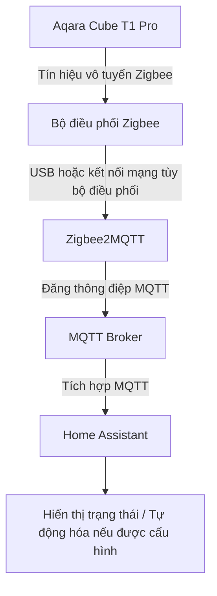
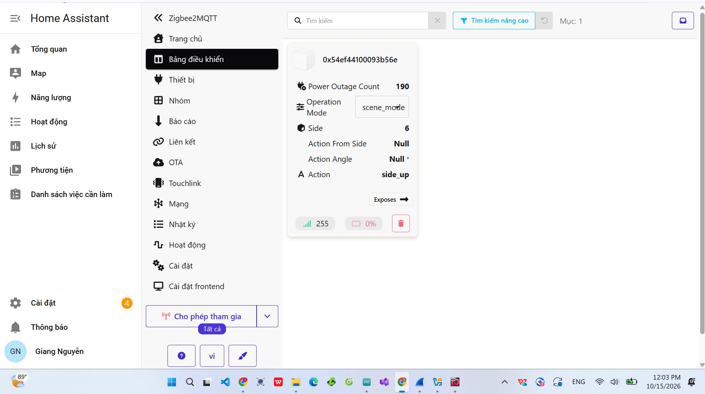
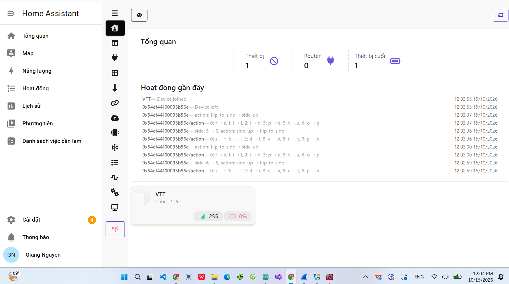

<p>BÀI THỰC HÀNH – KẾT NỐI VÀ GIÁM SÁT AQARA CUBE T1 PRO BẰNG ZIGBEE2MQTT TRÊN HOME ASSISTANT</p>

Tài liệu thực hành này được viết dựa trên ba ảnh chụp màn hình Zigbee2MQTT và video `zigbee.mp4` của bài thực tế. Mục tiêu là giúp các bạn hiểu cách kết nối một bộ điều khiển khối lập phương Zigbee, theo dõi hành động của nó và biết cách ứng dụng dữ liệu đó để điều khiển thiết bị trong Home Assistant.

Thiết bị xuất hiện trong ảnh là Aqara Cube T1 Pro, mã CTP-R01, có tên thân thiện `VTT` trong danh sách Zigbee2MQTT. Trong video, việc xoay và lật khối lập phương được thực hiện trước camera, đồng thời các trường dữ liệu trên bảng điều khiển thay đổi. Bài này chứng minh quá trình nhận thao tác Zigbee; các ảnh/video không cho thấy một thiết bị đèn được Cube điều khiển tự động.

---

<p>1. MỤC ĐÍCH BÀI THỰC HÀNH</p>

- Hiểu Zigbee là giao thức truyền thông không dây dùng cho các thiết bị IoT công suất thấp.
- Biết vai trò của bộ điều phối Zigbee (coordinator), Zigbee2MQTT, MQTT broker và Home Assistant.
- Ghép đôi Aqara Cube T1 Pro với mạng Zigbee do Zigbee2MQTT quản lý.
- Quan sát dữ liệu hành động khi nghiêng, lật hoặc xoay khối lập phương.
- Đọc các mục `operation_mode`, `side`, `action`, `action_from_side`, `action_angle`, `LQI` và `battery`.
- Biết cách phát triển thêm một tự động hóa Home Assistant nhận thao tác từ Cube để điều khiển LED.

---

<p>2. THIẾT BỊ VÀ PHẦN MỀM CẦN CHUẨN BỊ</p>

- 01 bộ điều khiển Aqara Cube T1 Pro (model CTP-R01).
- Pin CR2450 lắp trong Cube, còn đủ điện để thiết bị hoạt động.
- 01 bộ điều phối Zigbee tương thích với Zigbee2MQTT; có thể dùng loại kết nối USB hoặc loại nối mạng được hỗ trợ. Ảnh bài thực hành không thể hiện chính xác model coordinator.
- Máy chủ chạy Home Assistant.
- MQTT broker hoạt động, ví dụ Mosquitto, và Zigbee2MQTT đã được cấu hình để kết nối đến broker.
- Trình duyệt hoặc điện thoại truy cập được giao diện Home Assistant / Zigbee2MQTT.

Lưu ý: Cube kết nối không dây bằng Zigbee đến coordinator. Không kết nối trực tiếp Cube vào WiFi hoặc Bluetooth của điện thoại để thực hiện bài này. WiFi/Ethernet có thể được sử dụng ở phần mạng máy chủ, nhưng không thay thế đường truyền Zigbee của Cube.

---

<p>3. SƠ ĐỒ NGUYÊN LÝ HOẠT ĐỘNG</p>



Nguyên lý:

1. Người dùng lật hoặc xoay Cube.
2. Cube phát bản tin Zigbee về coordinator.
3. Zigbee2MQTT giải mã sự kiện và chuyển dữ liệu sang MQTT.
4. Giao diện Zigbee2MQTT hiển thị thông tin như mặt hướng lên và tên hành động.
5. Khi đã tích hợp MQTT với Home Assistant, dữ liệu có thể được dùng làm bộ kích hoạt cho tự động hóa. Khâu điều khiển thiết bị khác là phần mở rộng, không phải kết quả đã chứng minh trong ảnh.

---

<p>4. THÔNG TIN THIẾT BỊ QUAN SÁT TỪ BÀI LÀM</p>

<table>
<tbody>
<tr><td>Tên thân thiện</td><td>VTT</td></tr>
<tr><td>Nhà sản xuất</td><td>Aqara</td></tr>
<tr><td>Model</td><td>CTP-R01 (Cube T1 Pro)</td></tr>
<tr><td>Địa chỉ IEEE trong ảnh</td><td><code>0x54ef44100093b56e</code></td></tr>
<tr><td>Chế độ trong ảnh bảng điều khiển</td><td><code>scene_mode</code></td></tr>
<tr><td>Mặt được ghi nhận trong một ảnh</td><td><code>side: 6</code></td></tr>
<tr><td>Hành động được ghi nhận</td><td><code>action: side_up</code></td></tr>
<tr><td>Chất lượng liên kết hiển thị</td><td><code>LQI: 255</code> tại thời điểm chụp</td></tr>
<tr><td>Pin hiển thị</td><td>0% tại thời điểm chụp; cần kiểm tra lại, không đủ cơ sở kết luận pin còn tốt</td></tr>
<tr><td>Trạng thái trong ảnh danh sách thiết bị</td><td>Hiển thị “Đã vô hiệu hóa” tại thời điểm chụp</td></tr>
</tbody>
</table>

Thông số trên chỉ phản ánh thời điểm chụp ảnh. Không nên suy ra từ LQI 255 rằng thiết bị luôn kết nối ổn định; LQI không phải phần trăm dung lượng pin. Ảnh hoạt động gần đây còn ghi nhận sự kiện thiết bị vào/rời mạng, vì vậy cần kiểm tra trạng thái thực tế khi thực hành.

---

<p>5. HƯỚNG DẪN KẾT NỐI THIẾT BỊ VỚI ZIGBEE2MQTT</p>

Bước 1. Kiểm tra phần mềm.

- Home Assistant đã khởi động.
- MQTT broker đã hoạt động và Zigbee2MQTT kết nối đúng broker.
- Zigbee2MQTT đang dùng một coordinator tương thích và có thể mở được giao diện quản lý.

Bước 2. Mở Zigbee2MQTT từ giao diện Home Assistant rồi chọn mục “Cho phép tham gia” (Permit join). Trong Zigbee2MQTT, cửa sổ cho phép thiết bị mới tham gia mặc định kéo dài tối đa 254 giây; nên tắt quyền tham gia sau khi ghép đôi xong.

Bước 3. Ghép đôi Aqara Cube T1 Pro.

- Tháo nắp phía dưới khối Cube bằng dụng cụ phù hợp để nhìn thấy nút LINK.
- Nhấn giữ nút LINK khoảng 5 giây đến khi đèn báo màu xanh nháy ba lần.
- Đặt Cube gần coordinator và chờ Zigbee2MQTT hoàn thành quá trình nhận diện thiết bị (interview).
- Nếu thấy thiết bị đã tham gia nhưng quá trình nhận diện chưa hoàn tất, có thể nhấn ngắn nút LINK thêm vài lần theo hướng dẫn của Zigbee2MQTT.

Bước 4. Kiểm tra tab “Thiết bị” của Zigbee2MQTT. Thiết bị tương ứng được nhận diện là Aqara CTP-R01. Có thể đổi tên thân thiện thành `VTT` để thống nhất với bài mẫu, nhưng không bắt buộc.

Bước 5. Đóng chế độ “Cho phép tham gia” sau khi ghép đôi.

Chú ý: Nếu một thiết bị đã ghép đôi nhưng đang ở trạng thái vô hiệu hóa thì cần kiểm tra và bật lại trạng thái thiết bị trong Zigbee2MQTT; không nên hiểu “đã xuất hiện trong danh sách” đồng nghĩa chắc chắn còn đang truyền dữ liệu.

---

<p>6. HÌNH ẢNH 1 – GIAO DIỆN DANH SÁCH THIẾT BỊ</p>


Ảnh cho thấy thiết bị `VTT`, model `CTP-R01`, nhà sản xuất Aqara và chỉ số LQI 255. Tại thời điểm chụp, các mục “Lần cuối thấy” và “Tính khả dụng” hiển thị “Đã vô hiệu hóa”. Đây là dữ liệu cần kiểm tra khi thử lại, không được bỏ qua trong báo cáo.

---

<p>7. HÌNH ẢNH 2 – BẢNG ĐIỀU KHIỂN VÀ DỮ LIỆU HÀNH ĐỘNG</p>



Ở ảnh này, Zigbee2MQTT hiển thị một thẻ dữ liệu với các trường `Operation Mode`, `Side`, `Action From Side`, `Action Angle` và `Action`. Trong lần ghi nhận này, `Operation Mode` là `scene_mode`, `Side` bằng 6 và `Action` là `side_up`.

`Action From Side` và `Action Angle` là `Null` trong ảnh. Đây không nhất thiết là lỗi: một số thao tác không mang thông tin mặt bắt đầu hoặc góc xoay.

---

<p>8. HÌNH ẢNH 3 – TỔNG QUAN MẠNG VÀ LỊCH SỬ HOẠT ĐỘNG</p>



Ảnh thể hiện tổng quan có 1 thiết bị Zigbee được ghi nhận, trong đó có 1 thiết bị cuối (end device) và 0 router Zigbee trong danh sách thống kê. Lịch sử hoạt động hiển thị các bản ghi thao tác và các sự kiện tham gia/rời mạng của thiết bị.

Cube là thiết bị đầu cuối dùng pin; các bộ định tuyến Zigbee (router) nếu có thường là những thiết bị được cấp nguồn thường xuyên và hỗ trợ chức năng định tuyến. Không được nhầm router Zigbee với bộ phát WiFi.

---

<p>9. GIẢI THÍCH CÁC TRƯỜNG THÔNG TIN</p>

<table>
<tbody>
<tr><td><code>operation_mode</code></td><td>Chế độ xử lý thao tác: <code>scene_mode</code> hoặc <code>action_mode</code>.</td></tr>
<tr><td><code>side</code></td><td>Mặt Cube được ghi nhận theo mã số của thiết bị.</td></tr>
<tr><td><code>action</code></td><td>Tên thao tác được Zigbee2MQTT phát hiện, ví dụ <code>side_up</code>.</td></tr>
<tr><td><code>action_from_side</code></td><td>Thông tin mặt ban đầu ở những thao tác có hỗ trợ trường này.</td></tr>
<tr><td><code>action_angle</code></td><td>Góc xoay trong những thao tác phù hợp, đơn vị độ (°).</td></tr>
<tr><td><code>LQI</code></td><td>Chỉ số chất lượng liên kết Zigbee (Link Quality Indicator); giá trị hiển thị phụ thuộc môi trường và thiết bị.</td></tr>
<tr><td><code>battery</code></td><td>Phần trăm pin được thiết bị báo cáo; có thể cập nhật chậm, không phải lúc nào cũng phản ánh ngay dung lượng thực tế.</td></tr>
<tr><td><code>power_outage_count</code></td><td>Trường do thiết bị báo cáo, không nên coi đây là số lần mất điện của cả hệ thống Home Assistant.</td></tr>
</tbody>
</table>

Hai chế độ của Cube T1 Pro không giống nhau:

- `scene_mode`: có thể phát hiện các hành động `side_up`, `flip_to_side`, `rotate_left`, `rotate_right`, `shake`, `throw`, `hold`, `1_min_inactivity`.
- `action_mode`: có thể phát hiện `slide`, `tap`, `flip90`, `flip180`, `rotate_left`, `rotate_right`, `shake`, `throw`, `1_min_inactivity`.

Các hành động được hỗ trợ theo tài liệu của model CTP-R01; không có nghĩa tất cả chúng đã được thử nghiệm trong video của bài này.

---

<p>10. CÁCH THỬ CÁC THAO TÁC VỚI CUBE</p>

1. Mở trang “Bảng điều khiển” của Zigbee2MQTT hoặc mục “Thiết bị” và chọn Cube.
2. Kiểm tra `operation_mode`. Với video và ảnh của bài, chế độ được ghi nhận là `scene_mode`.
3. Đặt một mặt bất kỳ của Cube ngửa lên và quan sát thay đổi của `side` hoặc `action`.
4. Lật sang mặt khác và kiểm tra hành động được gửi về.
5. Xoay Cube trên mặt phẳng và theo dõi các sự kiện xoay nếu thao tác được nhận diện.
6. Ghi lại tên hành động và mặt Cube ở từng lượt thử, sau đó đối chiếu trên Zigbee2MQTT.

Bảng gợi ý kiểm tra:

<table>
<tbody>
<tr><td>Đặt/lật Cube để một mặt hướng lên</td><td>Có thể nhận <code>side_up</code> hoặc <code>flip_to_side</code> trong scene mode</td></tr>
<tr><td>Xoay Cube sang trái</td><td>Có thể nhận <code>rotate_left</code></td></tr>
<tr><td>Xoay Cube sang phải</td><td>Có thể nhận <code>rotate_right</code></td></tr>
<tr><td>Lắc Cube</td><td>Có thể nhận <code>shake</code></td></tr>
<tr><td>Để Cube không thao tác một thời gian</td><td>Có thể nhận <code>1_min_inactivity</code> nếu thiết bị báo sự kiện</td></tr>
</tbody>
</table>

Đây là kết quả mong đợi, không phải lời khẳng định rằng mọi lượt thao tác sẽ phát bản tin trong mọi điều kiện. Hãy kiểm tra nhật ký thực tế để xác nhận.

---

<p>11. CHUYỂN CHẾ ĐỘ SCENE MODE VÀ ACTION MODE</p>

Cube T1 Pro hỗ trợ hai cách chuyển chế độ theo tài liệu Zigbee2MQTT:

- Cách phần cứng: mở nắp, bấm nút LINK năm lần liên tiếp.
- Cách phần mềm: vào trang thiết bị Zigbee2MQTT, tìm trường `operation_mode` trong mục Exposes và chọn `scene_mode` hoặc `action_mode`.

Thay đổi chế độ bằng phần mềm có thể không có hiệu lực ngay do Cube là thiết bị dùng pin và chỉ lắng nghe cấu hình ở một số thời điểm. Có thể đánh thức thiết bị bằng nút LINK theo hướng dẫn của nhà cung cấp. Không tự ý coi màn hình đã chọn chế độ mới là bằng chứng chế độ đã áp dụng; cần thao tác kiểm tra lại.

---

<p>12. XEM DỮ LIỆU QUA MQTT (DÀNH CHO CÁC BẠN MUỐN TÌM HIỂU SÂU HƠN)</p>

Nếu tên MQTT của Cube là `VTT` và Zigbee2MQTT dùng tiền tố topic mặc định `zigbee2mqtt`, các bản tin trạng thái thường được công bố trên topic:

```text
zigbee2mqtt/VTT
```

Một ví dụ minh họa cấu trúc JSON từ các trường quan sát được:

```json
{
  "action": "side_up",
  "side": 6
}
```

Đây là ví dụ rút gọn để giải thích dữ liệu, không phải bản tin MQTT nguyên văn được trích xuất từ video. Payload thực tế có thể chứa thêm trường; topic cũng thay đổi nếu bạn đã đổi `friendly_name` hoặc `base_topic`.

---

<p>13. VÍ DỤ MỞ RỘNG – LẮC CUBE ĐỂ BẬT/TẮT LED TRÊN HOME ASSISTANT</p>

Phần này là ví dụ phát triển thêm, không có bằng chứng trong ảnh/video rằng bạn đã tạo và chạy automation này. Nếu bạn đã có LED RGB từ bài Home Assistant trước đó và đã cấu hình tích hợp MQTT, có thể tạo tự động hóa như sau:

```yaml
alias: Vi du - Lac Zigbee Cube de bat tat LED
triggers:
  - trigger: mqtt
    topic: "zigbee2mqtt/VTT"
    payload: "shake"
    value_template: "{{ value_json.action }}"
conditions: []
actions:
  - action: light.toggle
    target:
      entity_id: light.nguyevietgiang_led_rgb_7_mau
mode: single
```

Cách sử dụng:

1. Home Assistant → Cài đặt → Tự động hóa & Cảnh → Tạo tự động hóa.
2. Chuyển sang chỉnh sửa YAML và dán ví dụ trên.
3. Kiểm tra topic MQTT `zigbee2mqtt/VTT` có đúng tên thiết bị thực tế hay không.
4. Kiểm tra `light.nguyevietgiang_led_rgb_7_mau` có đúng là thực thể LED đang sử dụng hay không.
5. Lưu tự động hóa và kiểm tra bằng cách lắc Cube.

Nếu không có LED hoặc không muốn điều khiển LED, có thể thay `light.toggle` bằng hành động phù hợp với thiết bị khác. Không cần viết đoạn automation này chỉ để xem các hành động Cube trên Zigbee2MQTT.

---

<p>14. VIDEO THỰC HÀNH</p>

[Nhấn để xem video kết nối và thử thao tác Aqara Cube](zigbee.mp4)

Video dài khoảng 31 giây. Video cho thấy thiết bị Cube được đặt trước máy tính và người thực hiện thay đổi tư thế Cube, trong khi giao diện Zigbee2MQTT hiển thị các cập nhật về mặt và hành động. Video minh họa việc giám sát dữ liệu thao tác, không chứng minh có tự động hóa bật/tắt một thiết bị khác.

---

<p>15. MỘT SỐ LỖI THƯỜNG GẶP VÀ CÁCH KIỂM TRA</p>

<table>
<tbody>
<tr><td>Không thấy thiết bị sau khi ghép đôi</td><td>Kiểm tra coordinator, bật “Cho phép tham gia”, giữ Cube gần coordinator và thực hiện lại thao tác LINK.</td></tr>
<tr><td>Đã xuất hiện nhưng chưa hoàn tất nhận diện</td><td>Chờ kết thúc interview; có thể bấm ngắn LINK theo hướng dẫn model CTP-R01.</td></tr>
<tr><td>Không thấy hành động mới</td><td>Kiểm tra thiết bị có đang bị vô hiệu hóa hay không, tình trạng kết nối Zigbee, pin và nhật ký Zigbee2MQTT.</td></tr>
<tr><td>Chế độ không đổi ngay</td><td>Do Cube có thể ngủ để tiết kiệm pin; đánh thức qua LINK và kiểm tra lại sau khi gửi chế độ.</td></tr>
<tr><td>Pin hiển thị 0%</td><td>Kiểm tra trạng thái báo pin và pin CR2450 thực tế. Số liệu pin có thể cập nhật trễ.</td></tr>
<tr><td>LQI thấp hoặc kết nối chập chờn</td><td>Đặt coordinator tránh xa nguồn nhiễu USB 3.0/WiFi, dùng dây USB nối dài nếu cần và kiểm tra khoảng cách.</td></tr>
<tr><td>Không chạy ví dụ lắc Cube để bật LED</td><td>Kiểm tra MQTT integration, topic/friendly name, action `shake`, thực thể LED, trạng thái automation và nhật ký.</td></tr>
</tbody>
</table>

---

<p>16. NHẬN XÉT KẾT QUẢ VÀ KẾT LUẬN</p>

Kết quả quan sát được từ tư liệu thực hành:

- Zigbee2MQTT nhận diện thiết bị Aqara Cube T1 Pro (CTP-R01), có tên thân thiện `VTT`.
- Giao diện có phần hiển thị thông số liên kết Zigbee và các trường mô tả thao tác.
- Bảng điều khiển ghi nhận `scene_mode`, `side_up` và giá trị mặt Cube tại thời điểm chụp.
- Video thể hiện việc thao tác Cube trong khi dữ liệu trên màn hình cập nhật.
- Một ảnh danh sách ghi “Đã vô hiệu hóa”, ảnh khác hiển thị 0% pin và lịch sử có sự kiện tham gia/rời mạng. Những dữ liệu này cần kiểm tra thêm nếu muốn kết luận hệ thống hoạt động ổn định liên tục.

Thông qua bài thực hành, các bạn có thể hiểu cách gửi thao tác không dây từ một thiết bị Zigbee về Zigbee2MQTT và quan sát trạng thái trên giao diện Home Assistant. Có thể mở rộng thành hệ thống điều khiển đèn, quạt hoặc các thiết bị nhà thông minh bằng cách xây dựng tự động hóa MQTT hoặc thông qua các trigger thiết bị phù hợp.

---

<p>17. TÀI LIỆU THAM KHẢO CHÍNH THỨC</p>

- [Aqara Cube T1 Pro (CTP-R01) – thiết bị, chế độ, thao tác và ghép đôi](https://www.zigbee2mqtt.io/devices/CTP-R01.html)
- [Hướng dẫn cài đặt Zigbee2MQTT](https://www.zigbee2mqtt.io/guide/getting-started/)
- [Cho phép thiết bị Zigbee tham gia và ghép đôi](https://www.zigbee2mqtt.io/guide/usage/pairing_devices.html)
- [Tích hợp Zigbee2MQTT với Home Assistant](https://www.zigbee2mqtt.io/guide/usage/integrations/home_assistant.html)
- [Home Assistant – MQTT trigger](https://www.home-assistant.io/triggers/mqtt/)

---

<p>18. DANH SÁCH TỆP CỦA BÀI</p>

```text
BÀI ZIGBEE/
├── README.md
├── ZIGBEE (2).png    # Danh sách thiết bị
├── ZIGBEE.png        # Bảng điều khiển Cube
├── ZIGBEE3.png       # Tổng quan mạng và nhật ký
├── zigbee.mp4        # Video thực hành
├── automation_cube_vi_du.yaml  # YAML mở rộng, không bắt buộc
└── Bao_cao_Zigbee_Times_New_Roman_13.docx  # Bản Word
```

Lưu ý khi đưa lên GitHub: giữ nguyên tên tệp, dấu cách, chữ hoa và chữ thường để ảnh/video xuất hiện đúng. Đặt README.md ở cùng thư mục với ba ảnh và video. GitHub sẽ hiển thị nội dung README phía dưới danh sách tệp của thư mục đó.
